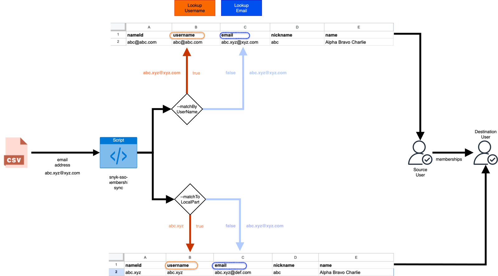

# Snyk SSO Membership Tool

This command-line tool helps Snyk Group Administrators manage user memberships during a Single Sign-On (SSO) domain migration. It simplifies migrating Group and Organization memberships for users represented across two different email domains on an SSO connection.

For example, migrating a user from:

- `user@source.com` to `user@destination.com` (by `email` property)
- `user@source.com` to `user` (by `username` property)

## Table of Contents

- [Key Features](#key-features)
- [Getting Started](#getting-started)
  - [Prerequisites](#prerequisites)
  - [Installation](#installation)
  - [Build](#build)
- [Usage](#usage)
  - [`sync`](#sync-synchronizing-user-memberships)
  - [`get-users`](#get-users-getting-sso-users)
  - [`delete-users`](#delete-users-deleting-sso-users)
  - [`generate-memberships-json`](#generate-memberships-json-export-users-and-memberships)
  - [`delete-memberships-from-json`](#delete-memberships-from-json-delete-memberships-for-users-in-json)
  - [`assign-memberships-from-json`](#assign-memberships-from-json-assign-memberships-to-users-from-json)
- [How Snyk User Profiles are Matched](#how-snyk-user-profiles-are-matched)
- [⚠️ Important Behavior](#️-important-behavior)
- [Logging](#logging)
- [License](#license)

## Key Features

*   **Synchronize Memberships**: Copy a user's Snyk Group and Organization roles from a source account to a destination account.
*   **Delete Users**: Bulk-delete Snyk SSO users from a specific domain.
*   **Flexible User Matching**: Match Snyk users by email, username, or the local-part of an email address to accommodate complex identity provider (IdP) setups.
*   **IdP Migration Workflow**: Export memberships as JSON, assign them to users in a new IdP, and clean up old memberships without deleting user accounts.

## Getting Started

### Prerequisites

You will need a Snyk Service Account API token with the **Group Admin** role. Export it as an environment variable:

```bash
export SNYK_TOKEN=<your_snyk_api_token>
```

### Installation

Download the appropriate binary for your system from the latest [GitHub release](https://github.com/snyk/snyk-sso-membership/releases).

### Build

To build the `snyk-sso-membership` executable from source:

```bash
make build
```

## Usage

The tool provides the following commands: `sync`, `get-users`, `delete-users`, `generate-memberships-json`, `delete-memberships-from-json`, and `assign-memberships-from-json`.

### `sync`: Synchronizing User Memberships

This command synchronizes Group and Organization memberships from users on a source domain to users on a destination domain.

> [!WARNING]
> The `sync` command performs a **full synchronization**. The destination user's list of Organization memberships will become an exact mirror of the source user's. Any memberships the destination user had that the source user did not will be **deleted**.

#### Sync All Users in a Group

This command finds pairs of users across two domains who share the same local-part (username) in their email address.

```bash
snyk-sso-membership sync <groupID> --domain=source.com --ssoDomain=destination.com
```

#### Sync a Selective List of Users

You can provide a CSV file containing a list of source user emails to sync.

**Example `users.csv`:**
```csv
user1@source.com
user2@source.com
```

**Command:**
```bash
snyk-sso-membership sync <groupID> --domain=source.com --ssoDomain=destination.com --csvFilePath="./users.csv"
```

#### `sync` Command Options

| Option | Description |
| --- | --- |
| `--domain` | The source domain to match users from. |
| `--ssoDomain` | The destination domain to sync memberships to. |
| `--csvFilePath` | Path to a CSV file containing a list of user emails to sync. |
| `--matchByUserName` | Match users by their `username` property instead of `email`. |
| `--matchToLocalPart`| Match the local-part of the source user's email to the destination user's `username`. Mutually exclusive with `--ssoDomain`. |

#### `sync` Flow Diagram



### `get-users`: Getting SSO Users

This command retrieves SSO users from the SSO connection tied to the Snyk Group. You can redirect the output to a CSV file.

#### Get All Users

```bash
snyk-sso-membership get-users <groupID> > myusers.csv
```

#### Get Users by Domain, Email, or CSV

```bash
# Get all users by email domain
snyk-sso-membership get-users <groupID> --domain=source.com > myusers.csv

# Get a single user by email
snyk-sso-membership get-users <groupID> --email=user1@source.com > myusers.csv

# Get a list of users from a CSV file
snyk-sso-membership get-users <groupID> --csvFilePath="./users.csv" > myusers.csv
```

### `delete-users`: Deleting SSO Users

This command deletes SSO users by email address or unique user ID.

> [!NOTE]
> The `delete-users` command triggers standard Snyk email notifications to affected users (e.g., "Your Snyk account was deleted"). This is a platform-level behavior and cannot be configured.

#### Delete Users by Domain, Email, or CSV

```bash
# Delete all users by email domain
snyk-sso-membership delete-users <groupID> --domain=source.com

# Delete a single user by email
snyk-sso-membership delete-users <groupID> --email=user1@source.com

# Delete a list of users from a CSV file
snyk-sso-membership delete-users <groupID> --csvFilePath="./users.csv"
```

### `get-users` and `delete-users` Command Options

| Option | Description |
| --- | --- |
| `--matchByUserName` | Use this flag to identify users by their `username` property instead of `email`. |

### `generate-memberships-json`: Export users and memberships

Export users and their full Group/Org memberships as JSON for IdP migration workflows.

```bash
# Export all users in a domain
snyk-sso-membership generate-memberships-json <groupID> --domain=source.com > users_with_memberships.json

# Export specific users from a CSV (first column identifiers)
snyk-sso-membership generate-memberships-json <groupID> --csvFilePath="./users.csv" > users_with_memberships.json

# Export a single user by email
snyk-sso-membership generate-memberships-json <groupID> --email=user@source.com > user_with_memberships.json
```

Output shape:

```json
{
  "users": [
    {
      "id": "...",
      "username": "...",
      "email": "...",
      "name": "...",
      "active": true,
      "group_memberships": [
        { "membership_id": "...", "id": "<group_id>", "name": "...", "role_id": "...", "role_name": "..." }
      ],
      "org_memberships": [
        { "membership_id": "...", "id": "<org_id>", "name": "...", "role_id": "...", "role_name": "...", "org_id": "<org_id>", "role": "ADMIN|MEMBER|COLLABORATOR" }
      ]
    }
  ]
}
```

`org_memberships[*].org_id` and `role` are included to simplify provisioning via Snyk API.

### `delete-memberships-from-json`: Delete memberships for users in JSON

Delete only the Group/Org memberships for the users listed in a JSON file (generated by `generate-memberships-json`). This avoids deleting newly provisioned users on another SSO connection.

```bash
snyk-sso-membership delete-memberships-from-json <groupID> --input=users_with_memberships.json
```

This command:
- Deletes listed users' Org memberships by `org_id` + `membership_id`
- Deletes listed users' Group memberships by `groupID` + `membership_id`
- Does not delete user accounts

### `assign-memberships-from-json`: Assign memberships to users from JSON

Assign Group and Org memberships to users in a source group based on the JSON file generated by `generate-memberships-json`. This matches users from the source group to the JSON by email (or username) and applies the memberships listed in the JSON using the existing membership creation logic.

```bash
snyk-sso-membership assign-memberships-from-json <sourceGroupID> --input=users_with_memberships.json
```

**Workflow (3-step IdP migration)**:
1. **Step 1**: `generate-memberships-json` - Export users and memberships from old IdP group
2. **Step 2**: `assign-memberships-from-json` - Apply those memberships to users in new IdP group
3. **Step 3**: `delete-memberships-from-json` - Clean up old users' memberships

**Flags**:
- `--input`: Path to JSON file (required)
- `--matchByUserName`: Match users by `username` instead of `email` (default: false)

**Behavior**:
- Fetches all SSO users from `<sourceGroupID>`
- Matches each user to JSON entries by email (or username with `--matchByUserName`)
- For each match, creates/updates Group and Org memberships as defined in JSON
- Uses the same membership creation methods as the `sync` command
- Idempotent: ignores 409 conflicts if memberships already exist
- Only adds memberships listed in JSON; does not remove existing ones

## How Snyk User Profiles are Matched

A Snyk User is identified on the SSO connection through their profile attributes. The tool uses these attributes to find matching source and destination users.

**Example User Profiles:**
```json
{
    "type": "user",
    "id": "bb5f4804-7190-444e-99dc-47604ccd4867",
    "attributes": {
        "name": "Alpha Bravo Charlie",
        "email": "abc.xyz@xyz.com",
        "username": "abc@abc.com",
        "active": true
    }
},
{
    "type": "user",
    "id": "9fe58235-93c8-47b0-807a-ab3ac0bdb5aa",
    "attributes": {
        "name": "Alpha Bravo Charlie",
        "email": "abc.xyz@def.com",
        "username": "abc.xyz",
        "active": true
    }
}
```

## ⚠️ Important Behavior

> [!WARNING]
> Please read these points carefully before using the tool.
>
> *   **Destructive Sync:** The `sync` command performs a **full synchronization**. The destination user's list of Organization memberships will become an exact mirror of the source user's list. Any memberships the destination user had that the source user did not will be **deleted**.
> *   **Email Notifications:** The `delete-users` command triggers standard Snyk email notifications to the affected users (e.g., "Your Snyk account was deleted"). This is a platform-level behavior and cannot be configured.

## Logging

For every execution, a log file named `snyk-sso-membership_run_<YYYYMMDDHHMMSS>.log` is created in the directory where the tool is run.

## License

This project is licensed under the [Apache 2.0 License](LICENSE).